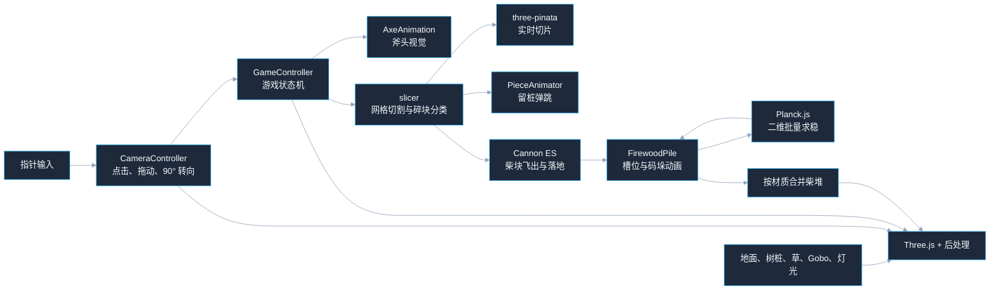
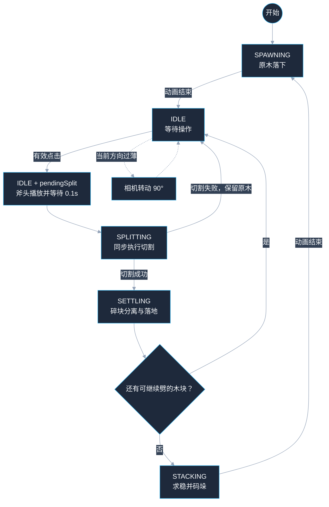
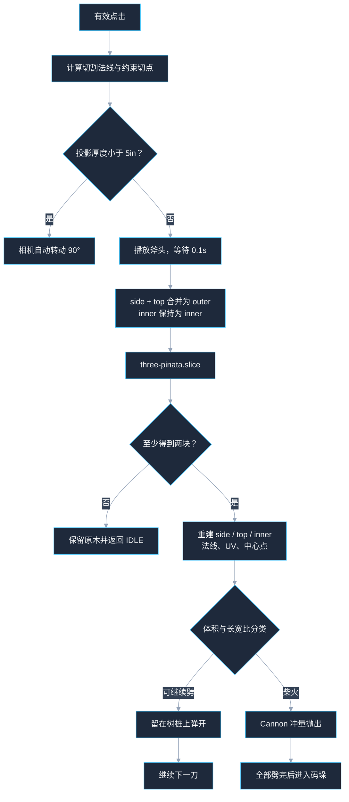

# Firewood — Web 3D 劈柴模拟器

这是一个用 Three.js 实现的浏览器端劈柴小游戏：玩家拖动视角、点击木块，斧头落下后实时切开程序化原木；达到柴火尺寸的碎块会经过 3D 物理掉落，再由 2D 物理计算稳定堆叠姿态，最后围绕树桩码成柴堆。

交互与技术思路来自公开可观察的劈柴玩法；实现与 **0.4.0 起的全部运行时素材** 均为本项目原创、合成，或来自 **CC0** 资源（见 [CREDITS.md](CREDITS.md)）。仓库内不再附带 screen.toys 拷贝素材。

> [!IMPORTANT]
> 发布前请阅读 `CREDITS.md`，并运行 `node scripts/check-ip-hashes.mjs` 确认没有重新引入已拉黑的旧资源哈希。

## 主要特性

- 程序化生成随机直径、长度和表面起伏的原木
- 使用 `three-pinata` 在浏览器中实时切割三角网格
- 树皮、端面年轮、内部木纹三套材质正确保留
- 依据体积、厚度和横截面长宽比判断是否还能继续劈
- 当前方向太薄时拒绝切割，并自动把相机精确转动 90°
- Cannon ES 模拟柴块飞出、翻滚、碰撞和落地
- Planck.js 把 3D 码垛降维成 2D 截面求稳
- 固定槽位、双支撑桥接和批量求稳，减少柴堆悬空与大缝隙
- 柴堆几何按材质合并，控制长期运行时的 draw call
- 斧头动画、镜头抖动、碰撞音效、风吹草地、树影光斑和景深
- 桌面端与移动端使用不同的草叶数量、阴影和景深参数

## 快速开始

建议使用 Node.js 20 或更高版本。

```bash
# 安装依赖，npm / pnpm 二选一
npm install
# pnpm install

# 确认 public/assets 与 public/basis 资源齐全，见“资源管理与部署”

# 开发服务器
npm run dev

# TypeScript 检查
npm run typecheck

# 生产构建，输出到 dist/
npm run build

# 用本地 HTTP 服务预览生产产物
npm run preview
```

开发服务器默认使用 Vite 的 `5173` 端口。项目使用 ES Module 和浏览器资源加载器，生产产物应通过 HTTP 服务访问，不建议使用 `file://` 直接打开 `dist/index.html`。

## 技术栈

| 技术 | 作用 |
| --- | --- |
| TypeScript | 业务代码、类型约束和模块组织 |
| Vite | 开发服务器、依赖预打包和生产构建 |
| Three.js | WebGL 渲染、场景、材质、动画、阴影和音频 |
| `@dgreenheck/three-pinata` | 对原木网格执行实时平面切割 |
| Cannon ES | 柴块飞出、落地和翻滚的 3D 刚体模拟 |
| Planck.js | 柴堆横截面的 2D 刚体求稳 |
| GLTFLoader + KTX2Loader | 加载斧头、树桩和 KTX2 压缩纹理 |
| EffectComposer + BokehPass | 后处理和景深 |
| Puppeteer Core | 开发期自动点击、截图和控制台错误检查 |

两个物理引擎不是重复使用：

- **Cannon ES** 只负责玩家刚劈出的柴块如何飞出去、碰撞和落地。
- **Planck.js** 只负责码垛时木块横截面如何稳定接触，再把结果映射回 3D。

## 系统架构



## 项目结构

```text
firewood/
├── index.html                     # 页面容器、加载界面和操作提示
├── package.json                   # 依赖与开发脚本
├── vite.config.ts                 # 相对路径构建、开发期资源兜底
├── public/
│   ├── assets/                    # 生产构建使用的贴图、模型和音效
│   └── basis/                     # KTX2 Basis 转码器
├── scripts/
│   └── shot.mjs                   # Puppeteer 截图与流程自检
└── src/
    ├── main.ts                    # 启动流程、模块组装和逐帧更新
    ├── style.css                  # 加载界面和操作提示样式
    ├── config/
    │   ├── constants.ts           # 相机、灯光、物理、原木、柴堆参数
    │   └── assets.ts              # 全项目唯一的资源 URL 清单
    ├── core/
    │   ├── renderer.ts            # Renderer、Scene 和 Fog
    │   ├── lights.ts              # 平行光、环境光和阴影
    │   ├── postprocess.ts         # Bokeh 景深后处理
    │   ├── gltf.ts                # GLTF + KTX2 加载器
    │   └── loading.ts             # 加载进度
    ├── camera/
    │   └── CameraController.ts    # 水平轨道相机、点击与拖拽判定
    ├── game/
    │   └── GameController.ts      # 核心状态机和完整劈砍流程
    ├── wood/
    │   ├── logFactory.ts          # 程序化原木
    │   ├── materials.ts           # side / top / inner 三套材质
    │   ├── slicer.ts              # 射线、切点、切片、UV 和分类
    │   └── warmup.ts              # 首次切片和着色器预热
    ├── physics/
    │   └── Physics.ts             # Cannon ES 封装
    ├── pile/
    │   ├── stackSolver.ts         # Planck 2D 批量求稳
    │   └── FirewoodPile.ts        # 槽位、3D 映射、动画和合并
    ├── anim/
    │   ├── AxeAnimation.ts        # 斧头 GLB 动画和重播
    │   └── PieceAnimator.ts       # 原木落下、留桩弹跳
    ├── world/
    │   ├── stump.ts               # 树桩模型及降级实现
    │   ├── ground.ts              # 地面
    │   ├── grass.ts               # 实例化草地和风动 Shader
    │   └── gobo.ts                # 程序化树影遮罩
    ├── audio/
    │   └── AudioManager.ts        # 音效加载、随机播放和解锁
    └── debug/
        └── DebugLine.ts           # 鼠标悬停时的切割预览线
```

## 启动与逐帧流程

页面加载时，`main.ts` 先同步创建渲染器、场景、相机、灯光、地面、草地、树影、物理世界和后处理。木材贴图、树桩和斧头会在 `boot()` 中并行加载；音效也会同时开始加载，但不会阻塞游戏启动。

可交互所需的贴图和模型加载完成后：

1. 给 Cannon 世界添加树桩圆柱碰撞体。
2. 在屏幕外执行数轮切割，预热 `three-pinata` 和相关 Shader。
3. 创建柴堆管理器与游戏状态机。
4. 释放 KTX2 转码 Worker。
5. 隐藏加载界面，显示操作提示。

`TOTAL_ASSETS` 包含音效数量，但 `boot()` 当前没有等待 `audio.ready`。因此加载遮罩关闭时，音效可能仍在后台加载，进度数字也可能尚未到达总数；首次几刀暂时无声属于当前实现的非阻塞加载行为。

每帧按以下顺序更新：

```text
CameraController
  → Cannon Physics
  → AxeAnimation
  → GameController
  → PieceAnimator
  → FirewoodPile
  → Grass / Gobo
  → EffectComposer.render()
```

帧间隔 `dt` 最大限制为 `0.05s`，避免浏览器标签页切到后台再回来时物理世界一次跨过太长时间。

## 游戏状态机



| 状态 | 主要行为 |
| --- | --- |
| `SPAWNING` | 新原木从树桩上方落下并弹跳，期间不接受劈砍 |
| `IDLE` | 更新悬停预览线，接受拖动和有效点击；`pendingSplit` 的 0.1 秒也仍处于此状态 |
| `SPLITTING` | 同步执行一次网格切片，是很短的过渡状态 |
| `SETTLING` | 留桩碎块弹开，柴火由 Cannon 模拟；点击会被消费但不会触发新劈砍 |
| `STACKING` | 计算整批柴火的槽位和稳定姿态，播放飞向柴堆的动画 |

`SETTLING` 返回 `IDLE` 或进入 `STACKING` 的条件是留桩动画结束；如果已经没有可劈木块，还会确保距离最后一刀至少经过 `500ms`。当前状态切换不依赖 Cannon 的 `allSettled()`。

## 劈砍逻辑详解

### 1. 区分点击与拖动

`CameraController` 记录指针按下到松开的水平累计位移：

- 位移不超过 `6px`：保存松手瞬间的 NDC 坐标，作为一次点击。
- 位移超过 `6px`：视为拖动，只旋转相机。
- 松手后保留角速度，产生帧率无关的惯性。

点击坐标会被冻结，后续鼠标移动不会改变这一次劈砍的射线方向。

### 2. 射线选择木块

`GameController` 只把同时满足以下条件的对象交给 `Raycaster`：

```text
isSplittable === true
isFirewood !== true
```

射线取距离相机最近的第一个命中点。鼠标悬停时使用同一套命中逻辑显示切割预览线。

### 3. 计算切割平面

真实劈柴沿木纹方向向下，切割平面必须包含原木的 Y 轴。实现中：

1. 读取相机局部 X 轴，也就是屏幕的“右方向”。
2. 把 Y 分量清零并归一化。
3. 将结果作为切割平面的法线。

因此切开的两部分会沿画面左右分开，而不会横着截断木纹。

### 4. 约束切点

用户点击的位置并不总是直接作为最终切点：

- 碎块估算体积不超过 `1000 in³` 时，从几何中心劈，避免小木块被切成过薄尖片。
- 更大的木块允许参考点击位置，但会把切点比例限制在 `1% ~ 99%`。
- 切点会继续被约束，尽量保证两侧估算体积都不低于 `500 in³`。
- 每一半在切割方向上的目标厚度至少为 `2.5in`。
- 对大木块进行切点约束时会保留点击高度 Y；较小木块则直接使用几何中心。

体积使用包围盒近似：

```text
volumeInches = bbox.x × bbox.y × bbox.z × 0.7 / INCH³
```

这里的 `0.7` 是针对不规则原木横截面的经验修正，不是精确网格体积积分。

### 5. 当前方向是否太薄

切割前会把碎块所有世界坐标顶点投影到切割法线上，计算该方向的总厚度。

```text
投影厚度 < 5in  →  当前方向不可劈
```

不可劈时不会调用切片库，而是根据点击发生在屏幕左侧还是右侧调用 `nudgeAzimuth()`。相机使用目标角指数缓动，最终严格累计 `±90°`；玩家主动拖动会取消自动转向。

### 6. 斧头与切割时机

有效点击会立即播放斧头视觉动画，并创建一个 `0.1s` 的 `pendingSplit`：

```text
点击 → 斧头出现 → 等待约 0.1s → 执行几何切割
```

斧头只负责视觉，真正的切割由 `GameController` 计时触发。快速重播时会重置：

- 斧头模型缩放
- 动画节点的位置、旋转和缩放
- `AnimationAction.reset().play()`
- `AnimationMixer` 的当前状态

因此上一段动画即使还未淡出，新一刀也能从完整可见状态开始。

### 7. 调用 three-pinata

渲染使用三种材质槽：

```text
0 = side  树皮
1 = top   上下端面年轮
2 = inner 已有切面和新切面
```

但 `three-pinata` 的 `DestructibleMesh` 只理解两类材质：

```text
0 = outer 原有外表面
1 = inner 切割产生的内部表面
```

所以切割前后需要一层转换：



具体步骤：

1. 克隆目标几何体，必要时转成非索引几何体。
2. 把 `side + top` 合并为外表面，把历史 `inner` 保留为内部表面。
3. 将世界切割平面转换到木块局部坐标。
4. 调用 `DestructibleMesh.slice()`。
5. 少于两块或出现退化三角形时放弃结果，保留原木。
6. 成功时再把每块碎片重建成三个渲染材质槽。

### 8. 重建切面、UV 和几何中心

切片后遍历三角形，根据面法线和来源材质重新分类：

- `|normal.y| > 0.95`：上下端面，使用 `top`
- pinata 的内部材质且不是端面：使用 `inner`
- 其他三角形：使用 `side`

新切面的顶点会沿切割法线增加最多约 `0.15in` 的正弦扰动，避免内部看起来像完全平整的塑料板。

UV 处理：

- 端面按本地 XZ 平面投影。
- 新切面以切割平面的水平轴和竖直轴投影。
- 旧表面继续使用原 UV。

重建后会用包围盒中心把每块几何体重新居中，再补偿 Mesh 的世界位置。后续左右判断、碰撞盒和码垛截面才能各自围绕真实碎块中心工作。

### 9. 碎块分类

每块碎片使用估算体积和水平截面长宽比分类：

| 条件 | 结果 |
| --- | --- |
| `volume <= 250 in³` | 柴火，不可继续劈 |
| `250 < volume <= 500 in³` 且长宽比 `<= 3` | 柴火，不可继续劈 |
| `250 < volume <= 500 in³` 且长宽比 `> 3` | 细长块被“救回”，仍可继续劈 |
| `volume > 500 in³` | 保留为可继续劈的木块 |

长宽比通过 XZ 顶点协方差的主轴计算，比直接比较包围盒 X/Z 更能适应旋转后的不规则碎块。

### 10. 劈开后的两条路径

**可继续劈的木块**

- 留在树桩上。
- 沿远离切点的方向移动约 `1in`。
- 使用 `150ms` 的弹跳和轻微倾斜动画。
- 邻近木块会按距离产生延迟和轻微位移。
- 在树桩半径约 `12in` 的圆内做边界约束。
- 使用二维凸包 SAT 迭代 5 次，减少留桩碎块互相穿插。

**已经成为柴火的木块**

- 沿远离切点方向平移 `3in`，并上移 `2in`。
- 加入 Cannon 世界，质量为 `0.5`。
- 施加水平和向上的线冲量，以及绕相机方向的随机角速度。
- 播放更长的断裂音效。

## 程序化原木

`logFactory.ts` 从 `CylinderGeometry` 开始生成原木：

- 直径：`9 ~ 16in`
- 长度：`12 ~ 16in`
- 环向分段：32
- 轴向分段：8
- 三组不同频率的正弦叠加为半径制造凹凸
- 底部的扰动略强，模拟根部不规则形状

侧面与端盖边缘必须使用完全相同的半径扰动公式。`three-pinata` 会根据顶点位置识别网格连通性；两边坐标哪怕只差一点，也可能把端盖识别成独立碎块，导致一刀切出异常数量的片段。

树皮 UV 只随机平移 U 相位，不沿 V 方向重复，避免原木中段出现水平接缝。端面则明确使用 XZ 平面 UV。

## 3D 掉落物理

`Physics.ts` 对 Cannon ES 做了薄封装：

- 重力：`-15 m/s²`
- Broadphase：SAP
- Solver 迭代：5
- 摩擦系数：0.8
- 回弹系数：0.15
- 地面：位于 `y = -0.33m` 的静态平面
- 树桩：16 边静态圆柱近似
- 柴块：包围盒 `CANNON.Box` 近似，不使用高成本凸包

柴块初始线性和角阻尼为 `0.3`，第一次碰撞后提高到 `0.95 / 0.98`，让木块快速稳定。如果 1 秒后还未进入睡眠，则强制清零速度并休眠。

这种碰撞盒是性能与视觉效果之间的取舍：不规则切片的真实凸包更准确，但数量增多后成本高、稳定性也更差。

## 2D 求稳与 3D 码垛

### 为什么码垛使用 2D

柴堆里的木块长轴大致朝向树桩，真正决定“会不会倒、是否悬空”的主要是横向与竖直组成的截面。因此项目只把每块柴的截面放入 Planck 世界求稳，再映射回圆弧上的 3D 位姿。

### 槽位布局

- 水平槽间距：`5in`
- 第一块位于 `(0, 0)`
- 地面层持续向左扩展
- 当下方左右两个槽都存在时，可以在中点建立上层槽
- 下层支撑高度超过 `18in` 时，不再继续桥接上层
- 优先选择更高、同时更靠近中心的合法槽位
- 当前圆弧空间不足时，下一批柴切换到更外侧一层

柴堆参数：

| 参数 | 值 |
| --- | --- |
| 起始角 | 320° |
| 圆弧跨度 | 230° |
| 起始半径 | 60in |
| 每层外扩 | 18in |

`PILE.maxRows` 目前是预留配置，当前层切换实际由圆弧长度是否容得下新槽位决定。

### Planck 批量求稳

同一轮要码垛的柴会一起进入一个临时 Planck 世界：

1. 地面和已经落位的截面作为静态刚体。
2. 新柴按支撑高度从低到高创建动态刚体。
3. 每块截面从几何顶点投影后取凸包。
4. 凸包最多简化为 8 个点；创建 Polygon 失败时退化成 Box。
5. 以 `1/60s` 步进，最多 400 次。
6. 每步强力抑制水平速度，150 步后继续增大阻尼。
7. 200 步后全部接近静止即可提前停止。
8. 最终 X 吸附回槽位中心，Y 限制在合理支撑高度附近。

Planck 重力为 `-10`，与 Cannon 的 `-15` 是两套独立世界，不应混为一个参数。

### 映射回 Three.js

二维结果包含 `(simX, simY, simAngle)`：

- `simX / radius` 转换成圆弧角度。
- `simY` 加到地面高度。
- 使用 `Matrix4.makeBasis()` 显式构造局部坐标基。
- 较薄的横截面方向保持竖直，避免柴块立在不稳定窄边上。
- `simAngle` 作为绕径向轴的自然倾斜角。

随后柴块经过飞行、落地、回弹三个阶段移动到目标位姿。动画开始时解除 Cannon 对该 Mesh 的控制。

### 合并柴堆

码垛完成后，柴块转成静态几何：

1. 分别抽取 `side / top / inner` 三个材质槽的三角形。
2. 每个材质桶内部先合并。
3. 再合成一个固定三组材质的 BufferGeometry。
4. 移除原来的独立 Mesh。

不能直接对所有多材质几何调用一次 `mergeGeometries(list, true)`，因为它会按输入几何序号建立材质组，而不是保留原来的材质索引，最终会出现树皮、端面和内部木纹错位。

合并能显著减少 draw call，但代价是已合并柴堆不能再单独推动某一块柴。

## 相机和交互

相机是围绕树桩的水平轨道相机：

- FOV：55°
- 距离：1.9m
- 俯仰角：约 20.6°
- 目标高度：0.13m
- 只开放水平旋转，俯仰和距离固定
- 松手后有指数衰减惯性
- 劈砍时有短促、高频、逐渐衰减的镜头抖动

固定俯仰和距离能让切割、拾取、柴堆构图始终处在可控范围内，也避免玩家把相机拖进地面。

## 渲染与环境效果

### Renderer 和灯光

- `WebGLRenderer({ antialias: true })`
- 设备像素比上限为 2
- `PCFShadowMap`
- `NeutralToneMapping`
- `SRGBColorSpace`
- 暖色平行光模拟太阳，冷色环境光补阴影
- 桌面阴影贴图 4096，移动端 2048
- 场景使用蓝灰色背景和距离雾

当前 Three.js 版本已不再使用旧的 `PCFSoftShadowMap`，阴影柔和度依赖阴影半径和采样参数。

### 草地

草叶使用实例化几何：

- 桌面端：10000 片
- 移动端：4000 片
- 顶点 Shader 根据高度、随机相位和时间产生风摆
- 根部基本不动，叶尖摆幅最大
- 片元 Shader 混合深绿、鲜绿和少量枯黄
- 根据太阳背光程度增加廉价的透光近似
- 草叶接收阴影但不投射阴影，避免阴影贴图噪点

实例位置在 Shader 中计算，因此关闭了视锥剔除。

### Gobo 树影

项目不创建完整树模型，而是：

1. 用 Canvas 生成透明底、不同大小的叶簇纹理。
2. 在太阳与场景之间放置两张相机不可见的平面。
3. 平面只参与阴影渲染，并在颜色材质和深度材质中都设置 `alphaTest`。
4. 缓慢平移两张纹理，形成随风移动的树影光斑。

透明底和深度材质的 `alphaTest` 都不可缺少，否则会投下一整块矩形阴影。

### 景深

后处理链：

```text
RenderPass → BokehPass → OutputPass
```

草叶是大量细长平面，如果进入景深的深度预渲染，会造成背景噪点和大面积模糊。因此 `postprocess.ts` 在 Bokeh 深度阶段临时隐藏草地，正常颜色渲染时再恢复。

## 音频

音频由 `AudioManager` 统一处理：

- `AudioListener` 挂在相机上。
- 同组音效随机播放，并避免连续重复同一个样本。
- 每次播放新建一个 `THREE.Audio`，允许多个碰撞声重叠。
- 浏览器首次 `pointerdown` 后才恢复 `AudioContext` 并播放背景音乐。
- 切后台再回来时尝试恢复音频上下文。
- 单个音频加载失败只会警告并跳过，不会让游戏白屏。

音效分组包括背景、落木、劈裂、断裂和码垛碰撞。

## 资源管理与部署

所有运行时 URL 集中在 `src/config/assets.ts`。配置清单要求：

```text
6 张木材贴图
4 个 GLB 模型
32 个 MP3
Basis 转码器 JS + WASM，二者缺一不可
```

生产资源目录：

```text
public/assets/   → 构建后 dist/assets/
public/basis/    → 构建后 dist/basis/
```

资源 URL 使用 `import.meta.env.BASE_URL`。`vite.config.ts` 设置 `base: "./"`，所以构建后的请求使用相对部署目录，而不是写死到域名根路径。

运行前应确认 `public/assets/` 完整（含 `stump-a/`、`stump-b/`、合成音效与 CC0 贴图）。缺少资源时开发和生产都会降级或 404。

替换素材有两种方式：

1. 在 `public/assets/` 中替换同名文件（并更新 `CREDITS.md`）。
2. 修改 `src/config/assets.ts` 中的集中路径。

树桩为外置 `stump.gltf`（色图 JPEG ≤1024、法线 PNG ≤512）。木桩 A/B 可在抽屉「风格」页切换。

### 加载失败的降级策略

| 失败项 | 处理方式 |
| --- | --- |
| 树桩模型 | 使用程序化圆台代替 |
| 斧头模型 | 不显示斧头，但切割逻辑继续运行 |
| 斧头挥砍 | 自研关键帧（约 0.28 秒） |
| 单个音效 | 跳过该音效，其他逻辑继续 |
| Planck Polygon | 退化为矩形 Box |
| 切割结果少于两块 | 放弃本次结果，保留原木 |

## 关键参数

场景统一使用米，业务尺寸通常先按英寸表达，再乘以：

```ts
INCH = 0.0254
FOOT = 0.3048
```

| 分类 | 参数 | 当前值 |
| --- | --- | --- |
| 点击 | 拖动判定阈值 | 6px |
| 切割 | 最小总投影厚度 | 5in |
| 切割 | 最小半边厚度 | 2.5in |
| 分类 | 柴火体积上限 | 500in³ |
| 分类 | 绝对柴火阈值 | 250in³ |
| 分类 | 细长块救回长宽比 | > 3 |
| 时序 | 点击到切割 | 约 0.1s |
| 时序 | 无留桩时最小等待 | 500ms |
| Cannon | 重力 | -15 |
| Planck | 重力 | -10 |
| Planck | 最大求解步数 | 400 |
| 柴堆 | 槽间距 | 5in |
| 柴堆 | 初始半径 | 60in |
| 柴堆 | 每层外扩 | 18in |

大部分可调整参数位于 `src/config/constants.ts`；切片分类阈值位于 `src/wood/slicer.ts`；槽位和求稳参数位于 `src/pile/`。

## 开发调试

开发构建会暴露 `window.__fw`：

| 调用 | 作用 |
| --- | --- |
| `__fw.look(deg)` | 直接设置相机方位角 |
| `__fw.nudge(1)` / `__fw.nudge(-1)` | 按正负方向自动转动 90° |
| `__fw.axe()` | 播放一次斧头动画 |
| `__fw.click()` | 从屏幕中心模拟一次有效点击 |
| `__fw.state()` | 查看游戏状态、斧头次数、码垛数和诊断信息 |
| `__fw.pile()` | 查看柴堆高度、动画状态和已求稳截面 |
| `__fw.stackTest(count)` | 用程序化整根原木测试槽位、Planck 和动画，不代表完整劈砍路径 |

这些钩子只存在于 `import.meta.env.DEV`，生产构建不会提供。

### 自动截图

`scripts/shot.mjs` 会启动临时 Vite 服务，用本机 Chrome 打开页面、收集错误并截图：

```bash
node scripts/shot.mjs /tmp/firewood.png

# 自动玩 4 刀
SHOT_PLAY=4 node scripts/shot.mjs /tmp/firewood-play.png

# 指定点击坐标
SHOT_CLICKS="640,300 640,340" node scripts/shot.mjs /tmp/firewood-clicks.png

# 调用开发钩子
SHOT_SCRIPT="look:90 stackTest:4" node scripts/shot.mjs /tmp/firewood-stack.png
```

脚本使用固定端口 `5199`，打开页面后默认等待 9 秒；`SHOT_STEP_WAIT` 可调整坐标点击和开发钩子之间默认 6 秒的等待。脚本当前固定使用 macOS 的 Google Chrome 路径；其他系统需要修改 `CHROME`。SwiftShader 软件渲染帧率较低，脚本会给每一步留出较长等待时间。它会收集并打印控制台、页面和网络错误，但目前不会仅因日志中有错误而返回非零退出码。

## 典型行为验证

| # | 输入或场景 | 预期结果 |
| --- | --- | --- |
| 1 | 首次打开页面 | 加载完成后出现树桩、草地、原木和操作提示 |
| 2 | 等待初始原木落下 | 状态从 `SPAWNING` 进入 `IDLE`，悬停可显示切割线 |
| 3 | 在 `IDLE` 点击可劈区域 | 斧头立即播放，约 0.1 秒后切割并进入 `SETTLING` |
| 4 | 按住拖动超过 6px 后松开 | 只旋转相机，不触发劈砍 |
| 5 | 当前切割方向厚度小于 5in | 不切割，相机根据点击侧自动转动 90° |
| 6 | `250 ~ 500in³` 且长宽比大于 3 | 识别为细长可劈块，继续留在树桩 |
| 7 | 体积不超过 500in³ 且未被救回 | 识别为柴火，加入 Cannon 飞出并落地 |
| 8 | `pendingSplit` 的 0.1 秒内或 `SETTLING` 期间再次点击 | 点击被消费，不创建第二个切割任务 |
| 9 | 最后一块可劈木头消失 | 等待至少 500ms 后整批进入 Planck 求稳和码垛 |
| 10 | 码垛动画结束 | 柴堆按三种材质合并，并生成下一根原木 |

## 已知限制

- 实时切割仍可能在非常薄或退化的几何上失败；失败时会保留原木。
- 斧头在真正切割前已经播放，因此切片随后失败时仍可能看到一次挥砍。
- 柴块的 Cannon 碰撞体是包围盒，视觉上足够稳定，但不是精确凸包。
- Cannon 是否完全睡眠不参与当前游戏状态跳转，码垛开始采用动画结束和最小等待时间。
- 柴堆完成后被合并为静态几何，不能再逐块施加物理效果。
- Planck 只求解码垛截面，不模拟完整 3D 柴堆侧向坍塌。
- 移动端通过 UA 判断降级，不是基于实时 GPU 性能评分。
- `scripts/shot.mjs` 当前依赖 macOS Chrome 固定路径。
- Vite 可能提示主 JS Chunk 超过 500kB；当前项目体量下不影响功能，后续可按场景和物理模块拆包。

## 设计取舍总结

这套实现的核心不是把所有问题都交给一个大型物理世界，而是把不同阶段拆开：

```text
交互选择        → Three.js Raycaster
真实网格切开    → three-pinata
留桩碎块反馈    → 轻量关键帧动画
柴块飞出落地    → Cannon ES 3D
柴堆稳定姿态    → Planck.js 2D
长期渲染性能    → BufferGeometry 材质分桶合并
```

这样既保留了“真的把网格劈开”的视觉可信度，也避免给所有木块长期运行完整 3D 刚体带来的性能和稳定性成本。

## 相关文档

- `NOTES.md`：开发过程中的技术决策和实现备注
- `CREDITS.md`：0.4.0 起全部运行时素材的来源与许可
- `REFERENCE_VERIFICATION.md`：劈砍逻辑对照与回归验证
- `FOUR_FIXES_VERIFICATION.md`：相机、90° 转向、码垛和斧头重播验证

